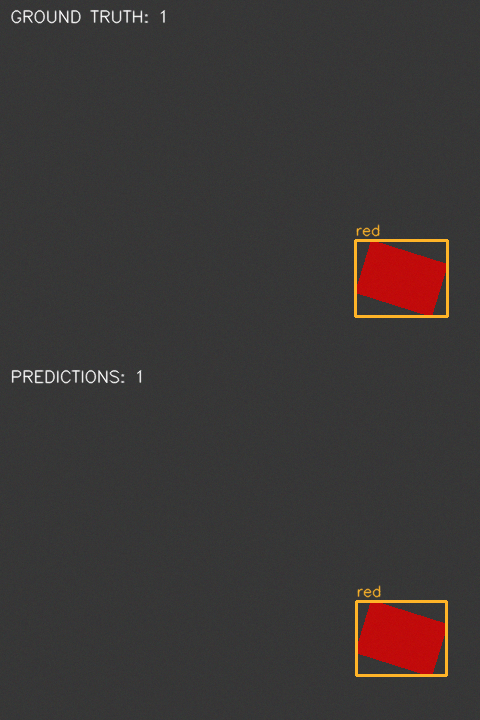

# Computer Vision Quality Inspection

A small Python/OpenCV program that counts and locates isolated **red and blue
rectangular parts** using HSV thresholds, morphology and contours. It saves
class-labeled bounding boxes, per-color counts and annotated images.

**All images are synthetic.** This is a color/count/location inspection exercise,
not a defect classifier or evidence of real-camera or industrial validation.
The code and experiments were implemented with AI assistance under student-defined
requirements; see the [contribution record](docs/CONTRIBUTIONS.md).

## Results

Parameters were selected on **15 development images**, then frozen before the
separate **30-image evaluation set** was generated (seed `92173`). At same-class,
one-to-one bounding-box IoU ≥ 0.5:

| Final synthetic evaluation | Result |
|---|---:|
| Annotated objects | 74 |
| TP / FP / FN | 74 / 0 / 0 |
| Precision / recall / F1 | 1.000 / 1.000 / 1.000 |
| Exact per-color counts | 30 / 30 images |
| Count MAE | 0.000 objects/image |

Conditions are nominal lighting, rotation, dim lighting, bright lighting and blue
background, with six images each. These results reflect a small, controlled
generator. They do not estimate performance on real photographs. The
[engineering report](docs/EVALUATION.md) records development failures and
separate stress demonstrations where the frozen detector fails.



## Setup

Tested on CPython **3.12.3**, Linux x86_64. From the repository root:

```bash
python3 -m venv .venv
source .venv/bin/activate
python -m pip install -r requirements-lock.txt
python -m pytest -q -rs
```

The pinned environment uses NumPy 2.5.4, OpenCV 4.14.0.94 and pytest 9.2.0.
`requirements.txt` also provides version ranges for other environments, which
may require a new freeze record. No GUI or display server is needed.
If a sourced ROS environment injects unrelated pytest plugins, prefix commands
with `env -u PYTHONPATH` to clear that inherited import path.

## Process images

```bash
python -m quality_inspection inspect --images examples/images --output runs/sample_inspection
```

The CLI reads supported PNG/JPEG/BMP/TIFF files directly inside one directory.
It writes one `*.annotated.png` per input and `detections.json` containing counts,
classes and `[x, y, width, height]` boxes. Use `--config path/to/config.json` to
select a configuration. Unreadable images fail with an explanatory error.
Output commands refuse nonempty destinations: choose a fresh path for a new run.
Existing full datasets may already be present in a working copy.

## Reproduce the experiment

```bash
python -m quality_inspection generate --output data/development
python -m quality_inspection evaluate --annotations data/development/annotations.json --config config/baseline.json --output runs/baseline
python -m quality_inspection evaluate --annotations data/development/annotations.json --output runs/development
python -m quality_inspection generate --split evaluation --frozen evidence/frozen.json --output data/evaluation
python -m quality_inspection evaluate --annotations data/evaluation/annotations.json --frozen evidence/frozen.json --output runs/evaluation_replay
```

`evidence/frozen.json` is the preserved original freeze. Its package-source,
configuration and exact runtime-version hashes must match. A replay reproduces
the same already-observed final set; it is not a fresh holdout experiment.
For automatic verification in a temporary clean source copy:

```bash
python scripts/verify_workflow.py
```

This runs all **48 tests**, generation, label rendering, directory inspection,
development evaluation and final evaluation, then compares the complete final
results JSON against the recorded experiment. The clean replay has been executed
successfully. All nine original detector cases run, with no skips.
The original test files were preserved.

For a future experiment, develop on development data, run tests, then create a
new record with `freeze --development ... --output ...` before generating new
holdout data. After observing a holdout, do not tune against it and describe
the result as an unbiased first evaluation.

## Design and repository

```text
quality_inspection/
  detector.py       Validate → HSV → masks → morphology → contours → boxes
  config.py         Validate JSON parameters
  models.py         Detection(label, bbox)
  dataset.py        Synthetic images and annotations
  evaluation.py     One-to-one matching and metrics
  visualization.py Image I/O and overlays
  reporting.py      Markdown evaluation report
  diagnostics.py    Development masks and HSV observations
  cli.py            generate / labels / inspect / freeze / evaluate
config/             Initial baseline and selected configuration
tests/              Contract, boundary, matching and integration checks
examples/           Two synthetic development inputs and ground-truth previews
evidence/           Frozen record, measured results, failures and example outputs
scripts/            Clean replay and reproducible stress examples
docs/               Evaluation, architecture, learning guide, CV and release draft
```

Only Python, OpenCV, NumPy and pytest are needed. There is no neural network,
tracking system, database or web interface. See [architecture](docs/ARCHITECTURE.md)
and the [annotation/evaluation protocol](docs/DATASET_AND_EVALUATION.md).

## Limitations and further learning

- Same-color parts that touch can become one contour.
- A background within the part's HSV range can become one large false detection.
- Parts below the configured contour-area cutoff are intentionally rejected.
- A dark marking can split one physical part into two foreground components.
- Thresholds and area cutoffs depend on illumination, camera response and scale.
- Perspective, occlusion, realistic reflections and real cameras were not tested.
- Public generator seeds make separation a documented workflow, not a secret benchmark.

See [recorded failures and results](docs/EVALUATION.md),
[validation](docs/VALIDATION.md), [learning and interview guide](docs/LEARNING_GUIDE.md),
and [CV wording](docs/CV.md). Full generated datasets, virtual environments and
scratch runs are ignored by Git. Selected evidence is retained deliberately.

GitHub publication and the proposed `v1.0.0` release require the owner's approval;
see the [release draft and publication instructions](docs/RELEASE_v1.0.0.md).
