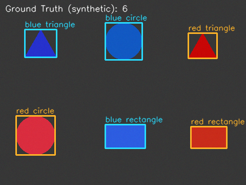
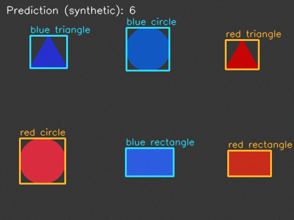
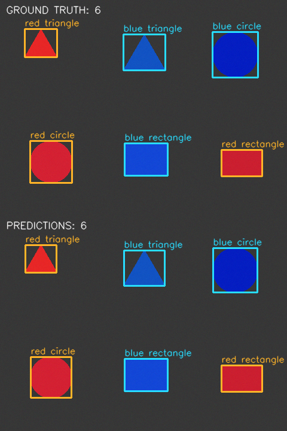
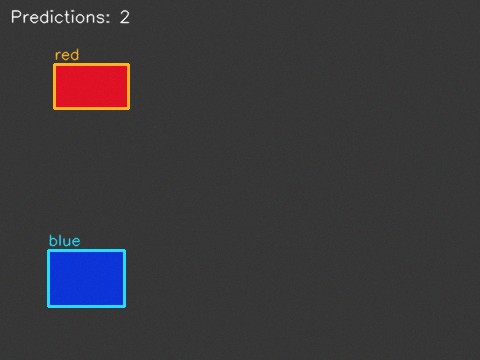

# Computer Vision Quality Inspection

A small **AI-assisted Python/OpenCV project** for synthetic part inspection.
It detects **red and blue rectangles, circles and triangles**, counts them,
and saves color/shape labels, bounding boxes and annotated images.

All images are **synthetic**. The project demonstrates classical image processing
and reproducible evaluation; no real-camera or industrial validation is claimed.
See the [contribution record](docs/CONTRIBUTIONS.md) for authorship.

## Example: six objects, two colors, three shapes

This fixed development example contains one red and one blue instance of every
shape. **Ground Truth** and **Prediction** are separate images; labels are visible
on each object. The images below are executed outputs, not mockups.





<<<<<<< HEAD
### Example detections

**Four parts in one evaluation image.** The top panel shows synthetic ground-truth
boxes; the bottom shows the detector predictions from the frozen evaluation.



**Both object colors.** Another saved detector output illustrates red and blue
part localization on a synthetic development image.


=======
[Original input](examples/images/showcase.png) · [Annotations](examples/annotations.json)
· [Detections](examples/detections.json)
>>>>>>> 444056a (Add classical shape inspection and reproducible mixed-object evaluation)

## Measured results

Selected parameters on 15 development images, then froze code/configuration
before generating a new 30-image final set. Matching requires **correct color,
correct shape and IoU ≥ 0.5**, with one-to-one assignment.

| Synthetic dataset | Objects | TP / FP / FN | Precision / recall / F1 | Exact total counts | Color-count accuracy | Shape-count accuracy |
|---|---:|---|---|---|---|---|
| Development, 15 images | 56 | 56 / 0 / 0 | 1.000 / 1.000 / 1.000 | 15/15 | 100% | 100% |
| Frozen final, 30 images | 110 | 110 / 0 / 0 | 1.000 / 1.000 / 1.000 | 30/30 | 100% | 100% |

Count accuracy means every entry in the image's color or shape count vector is
correct, including empty scenes. It is not object-level classification accuracy.
Final count MAE was 0. All 57 red and 53 blue objects matched: 36 rectangles,
37 circles and 37 triangles. Each of five conditions has six final images:
nominal, rotation, dim, bright and blue background.

These favorable results describe a small controlled generator, not arbitrary
photographs. [Evaluation and failures](docs/EVALUATION.md) includes the historical
color-threshold baseline on the new data and separate stress demonstrations.

## Setup and inspection

Tested with CPython 3.12.3 on Linux x86_64:

```bash
python3 -m venv .venv
source .venv/bin/activate
python -m pip install -r requirements-lock.txt
python -m pytest -q -rs
python -m quality_inspection inspect --images examples/images --output runs/sample_inspection
```

Only Python, OpenCV, NumPy and pytest are needed. There is no deep learning,
tracking, GUI, database or dashboard. The CLI reads PNG/JPEG/BMP/TIFF files
directly inside one directory and writes annotated PNGs plus detections.json,
including total, color and shape counts.

Use a fresh output directory for each run; commands refuse nonempty destinations.
If a sourced ROS setup injects unrelated pytest plugins, prefix Python commands
with `env -u PYTHONPATH`. The pinned versions are NumPy 2.5.4, OpenCV 4.14.0.94
and pytest 9.2.0. requirements.txt provides broader version ranges.

## Reproduce

New development seed: **31415**. New final seed: **271828**. Existing local data
may already be generated; skip completed steps or choose new paths.

```bash
python -m quality_inspection generate --output data/shapes_development
python -m quality_inspection evaluate --annotations data/shapes_development/annotations.json --output runs/development
python -m quality_inspection generate --split evaluation --frozen evidence/frozen.json --output data/shapes_evaluation
python -m quality_inspection evaluate --annotations data/shapes_evaluation/annotations.json --frozen evidence/frozen.json --output runs/final_replay
python scripts/verify_workflow.py
```

The verification script runs all **81 tests** in a temporary clean source copy,
regenerates data, renders labels, inspects images, exports the showcase and
compares the complete final results JSON exactly against the recorded experiment.
It has been executed successfully. All 48 pre-upgrade tests remain unchanged.

The preserved freeze requires matching package/configuration/runtime hashes.
A replay uses already-observed final images and is not a new independent
experiment. Future algorithm changes need development data and a fresh holdout:
freeze with `freeze --development ... --output ...` before final generation.
Never tune against the final set and report the improved run as an unbiased first result.

To reproduce the README assets into a fresh directory:

```bash
python -m scripts.export_examples --annotations data/shapes_development/annotations.json --output runs/showcase
```

## Design

```text
quality_inspection/
  detector.py        HSV masks, morphology, contours, shape rules and boxes
  models.py          Detection(color label, box, shape)
  dataset.py         Synthetic geometry and schema-v2 annotations
  evaluation.py     Joint color/shape matching and count metrics
  cli.py            generate / labels / inspect / freeze / evaluate
  config.py         Parameter validation
  visualization.py  Image I/O and labeled overlays
  reporting.py      Markdown metric reports
  diagnostics.py    Development-only masks and HSV observations
tests/              Original regression tests plus shape/showcase coverage
examples/           Stable six-object input, labels and separate output images
evidence/           Freeze, full results/annotations and representative failures
scripts/            Clean replay, showcase export and stress generation
docs/               Architecture, evaluation, CV, learning and release notes
```

Shape rules use polygon approximation: three convex vertices indicate a triangle;
four with sufficient rotated-rectangle fill indicate a rectangle; other convex
approximations with at least five vertices and sufficient circularity indicate
a circle. Unrecognized geometry is reported as `unknown`, not forced into a class.
See [architecture](docs/ARCHITECTURE.md) and [annotation/metric definitions](docs/DATASET_AND_EVALUATION.md).

## Limitations and portfolio notes

Touching parts may merge; markings may split contours; small parts are removed
by the area cutoff. Same-color backgrounds, clipping and shadows can defeat HSV
segmentation. Shape heuristics can confuse rounded polygons or ellipses with
circles, and some quadrilaterals with rectangles. No occlusion, perspective,
realistic optics or real-camera testing is claimed.

[Learning guide](docs/LEARNING_GUIDE.md) · [CV wording](docs/CV.md) ·
[Completion report](docs/COMPLETION_REPORT.md) · [Validation](docs/VALIDATION.md) ·
[Proposed v1.1.0 notes](docs/RELEASE_v1.1.0.md)

<<<<<<< HEAD
The repository is now publicly available on GitHub. The
[original release draft](docs/RELEASE_v1.0.0.md) predates publication and is
retained as a historical planning document, not as current push instructions.
=======
Implementation and experiments are AI-assisted; independent student implementation
has not been demonstrated. Dataset scratch files and checkpoints are ignored.
No push, tag or release is performed as part of this upgrade; publication requires approval.
>>>>>>> 444056a (Add classical shape inspection and reproducible mixed-object evaluation)
