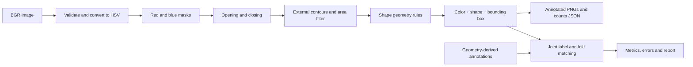

# Architecture

A small classical pipeline detects color, classifies shape, counts parts and
localizes them with axis-aligned boxes. It uses no trained model.

## Detector and shape heuristics

The detector has no file I/O. It validates uint8 BGR input, converts once, ORs
each color's HSV intervals, applies a 3×3 rectangular opening then closing,
and accepts external contours with area ≥400. Masks/images are not modified
in place. Results sort by color, y, x, width, height and shape.

For each contour, approximate its boundary with approxPolyDP at epsilon equal
to **0.03 × perimeter**. Classify in this order:

1. Three convex approximated vertices → triangle.
2. Four convex vertices and contour area / rotated minAreaRect area ≥ **0.85**
   → rectangle. Squares are included.
3. At least five convex approximated vertices and circularity
   **4π × area / perimeter² ≥ 0.80** → circle.
4. Otherwise → unknown.

Zero area/perimeter returns unknown. These fixed, development-checked heuristics
are intentionally limited: circularity is not a proof of circular geometry.
Ellipses/rounded polygons and some quadrilaterals can be misclassified.
The API operations are documented by OpenCV:
[contour features](https://docs.opencv.org/4.x/dd/d49/tutorial_py_contour_features.html)
and [contour properties](https://docs.opencv.org/4.x/d1/d32/tutorial_py_contour_properties.html).
The numerical cutoffs are project choices, not OpenCV guarantees.

## Data and evaluation

Detection retains `label` for color and adds `shape`. New schema-v2 annotations
require rectangle/circle/triangle explicitly. Predictions can also be unknown.
Two-argument Detection construction and schema-v1 annotations default to rectangle
for backward compatibility; new datasets never rely on that default.

The generator renders geometry independently of the detector. Each nonempty
scene has 3–6 separated objects, both colors and all shapes. Seeded variation
changes color values, sizes, positions and lighting/background conditions.
Image 001 is deliberately a six-object showcase covering all color/shape pairs.

Evaluation requires equal color AND shape before maximum-cardinality one-to-one
IoU≥0.5 matching. A wrong shape therefore creates an FP and an FN even when
color and total counts are correct. Reports include total and marginal color/
shape counts, per-condition metrics, per-color/per-shape TP/FP/FN and all boxes.

## Modules and reproducibility

CLI coordinates loading, validated parameters, detector calls and output.
Visualization and reporting render decisions; diagnostics exposes development
mask stages without accepting final data. Scripts reproduce the workflow,
export the development showcase and generate limitations demonstrations.

The freeze hashes Python files in quality_inspection/, config bytes and exact
Python/OpenCV/NumPy versions. Tests, helper scripts and Markdown are reviewed
through Git rather than included in that fingerprint. Evaluations record image
and annotation hashes. This is provenance checking, not secret benchmark protection.
