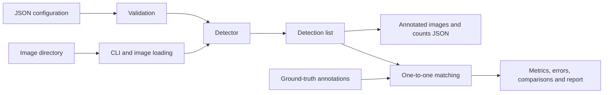

# Architecture

The detector is a small pure image-processing pipeline: it accepts a NumPy image
and validated configuration and returns detections without file I/O.

`Detection` is a frozen dataclass containing a class label and an integer box.
It represents one observation, not an identity tracked across frames.
Counts are derived from the returned list.

`detector.py` validates input, converts BGR to HSV once, then loops over colors.
`threshold_color` ORs the class's intervals. `filter_mask` applies rectangular
opening then closing. External contours are filtered by contour area; boxes
are sorted by label, y, x, width and height. Caller images/masks are unchanged.

`dataset.py` uses fixed independent RNG seeds and geometry-derived labels.
`evaluation.py` performs class-aware maximum-cardinality matching at fixed IoU,
then computes micro metrics and count errors. `cli.py` handles workflow, inputs,
output directories, provenance and report assembly. Visualization/reporting
render results without changing detection decisions.

`diagnostics.py` saves development-only masks and HSV observations.
`scripts/verify_workflow.py` replays the pipeline in a temporary clean source
copy; `scripts/make_stress_examples.py` generates limitations demonstrations.

The freeze record hashes every Python file in `quality_inspection/`, raw
configuration bytes and Python/OpenCV/NumPy versions. It does not hash Markdown,
tests, helper scripts or dependency files; those are reviewed through Git.
Evaluation JSON includes annotation/input hashes. This is an experiment
provenance check, not a secure benchmark service.
