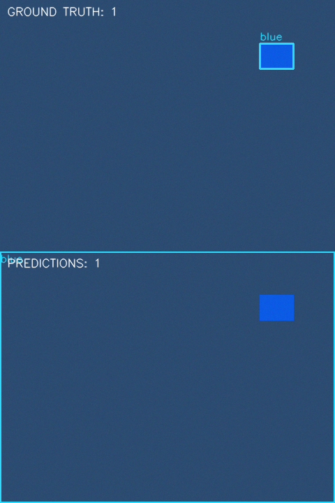
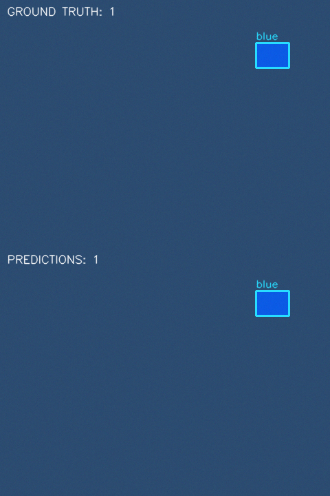
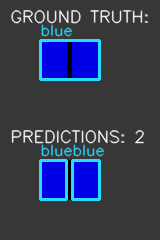

# Evaluation and failure analysis

All images are **synthetic**, generated with OpenCV/NumPy. No camera, robot or
production line was tested. Results cover isolated rectangular red/blue tiles
within the controlled generator.

## Method

Used 15 development images (seed 1729) to implement and select thresholds.
Finalized code/configuration, ran tests, and froze source/config/runtime in
[the freeze record](../evidence/frozen.json). Only then generated 30 final
images (seed 92173). There was no tuning after the final run.

Ground truth is a class and tight axis-aligned box around each rendered tile.
Same-class maximum-cardinality one-to-one matching at IoU ≥ 0.5 defines TP;
unmatched predictions are FP and unmatched annotations are FN. Precision, recall
and F1 are micro averages. See the [protocol](DATASET_AND_EVALUATION.md)
for formulas and coordinate rules.

## Measured results

| Set/configuration | Images | TP | FP | FN | Precision | Recall | F1 | Count MAE |
|---|---:|---:|---:|---:|---:|---:|---:|---:|
| Development, baseline | 15 | 35 | 21 | 2 | 0.625 | 0.946 | 0.753 | 1.400 |
| Development, rejected S≥180 candidate | 15 | 36 | 0 | 1 | 1.000 | 0.973 | 0.986 | 0.067 |
| Development, selected | 15 | 37 | 0 | 0 | 1.000 | 1.000 | 1.000 | 0.000 |
| Final, frozen selected configuration | 30 | 74 | 0 | 0 | 1.000 | 1.000 | 1.000 | 0.000 |

Development results are tuning feedback. The final set has 25 nonempty and five
empty images. Total and per-color counts were exact on 30/30 final images.
All 34 red and 40 blue objects matched. Minimum matched IoU was approximately 0.9365.

| Final condition | Images | Objects/TP | FP | FN | Precision | Recall | F1 |
|---|---:|---:|---:|---:|---:|---:|---:|
| Nominal | 6 | 17 | 0 | 0 | 1.000 | 1.000 | 1.000 |
| Rotation | 6 | 15 | 0 | 0 | 1.000 | 1.000 | 1.000 |
| Dim | 6 | 18 | 0 | 0 | 1.000 | 1.000 | 1.000 |
| Bright | 6 | 8 | 0 | 0 | 1.000 | 1.000 | 1.000 |
| Blue background | 6 | 16 | 0 | 0 | 1.000 | 1.000 | 1.000 |

Evidence: [complete detections, truth and matches](../evidence/final/results.json),
[generated report](../evidence/final/report.md), and
[full final annotation manifest](../evidence/evaluation_annotations.json).
That manifest's image paths refer to a regenerated dataset root.
Six representative inputs/comparisons are published; replay generates all 30.

## Development failures and decisions

V≥80 missed a dim blue tile with median value about 74; lowering V to 50
recovered it. Blue backgrounds with saturation around 155–157 passed S≥120.
One became a full-frame box, and an empty scene produced 20 false components.
Blue S≥175 removed these errors. Red retained S≥120: the common S≥180 candidate
lost a clipped bright red object with saturation near 170.





The [experiment log](EXPERIMENT_LOG.md) and development evidence preserve every
candidate, raw/filtered masks, pixel observations and before/after comparisons.
Hue bounds, 3×3 rectangular opening/closing, iterations and minimum contour area
400 remained fixed.

## Observed limitations outside the final set

No FP or FN occurred on the final 30 images at IoU≥0.5. Three additional
deterministic stress cases were evaluated afterward without any detector changes:

| Synthetic stress case | Observed result | Cause |
|---|---|---|
| 20×20 blue part | No detection; 1 FN | Contour area 361 < 400 |
| 5-pixel dark marking across a tile | 2 FP, 1 FN | Two boxes, each too small to match the full tile |
| Highly saturated blue background | 1 FP, 1 FN; total count correct | Background and foreground share the accepted color range |



Reproduce these demonstrations:

```bash
python scripts/make_stress_examples.py --output runs/stress_inputs
python -m quality_inspection evaluate --annotations runs/stress_inputs/annotations.json --output runs/stress_results
```

These are separate post-evaluation demonstrations, not random holdout images
or another generalization estimate. They motivated no changes.

Touching parts, perspective, occlusion, camera white balance, strong reflections
and realistic textured backgrounds remain unvalidated. There are only six
images per condition and they are not paired causal experiments. A new camera
setup needs fresh labeled development and held-out images, with scale-aware
area thresholds. Favorable synthetic results do not establish industrial suitability.
